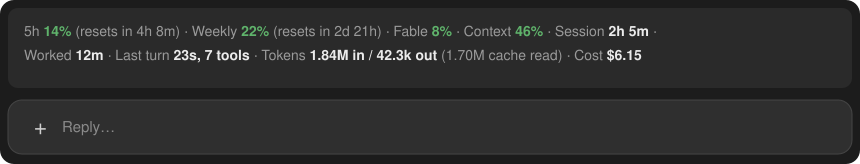

# usage-band

A Claude Code mod that adds one row above the prompt box with your plan usage and this session's numbers:



*Illustration with example values, not a screenshot.*

| Cell | What it shows |
| --- | --- |
| 5h | The 5-hour usage window and when it resets. Shown only on plans that have one (for example Max). |
| Weekly | The weekly window for all models and when it resets. |
| Fable | The weekly window for the Fable model, where your plan has one. |
| Context | How full the context window is, counted the way `/context` counts it. |
| Session | Time since the session first started. |
| Worked | Time Claude has spent working on turns this session. |
| Last turn | Length and tool-call count of the last finished turn. |
| Tokens | Input and output tokens since the mod loaded, subagents included, with the cache-read share of input. |
| Cost | The session's cost in US dollars, as `/cost` reports it (on a subscription, the API-price equivalent, not a charge). |

Percentages turn yellow from 70% and red from 90%. Cells wrap onto a new line when the window is narrow.

## Install

At the prompt of a Claude Code terminal session:

```
/plugin install usage-band --marketplace mnaami/claude-usage-band
```

Answer `y` to add the marketplace, then pick a scope (user scope loads it in every session).

From a shell:

```bash
claude plugin install usage-band --marketplace mnaami/claude-usage-band
```

In the Claude desktop app, where `/plugin` does not run: click + next to the prompt box, then Plugins, Add marketplace with `mnaami/claude-usage-band`, then Add plugin.

Sessions already open pick the mod up when they restart or resume.

## How it gets the numbers

- Context, cost, session start and the session's own rate-limit readings come from the Claude Code mod API (`$.session.usage()` and the `session.measure` event).
- The 5h, weekly and per-model weekly windows are also read from your account's usage (the same data as the app's usage card) when a session opens and every 5 minutes after, so a reopened session shows current figures. The request goes through Claude Code with your existing sign-in; the mod never sees the credential. That usage endpoint is not a documented API and may change; if it does, those cells fall back to the session's own readings or show `—`.
- Timing and token counts are kept by the mod from turn events, so they start at zero when the mod first loads in a session.

Nothing is sent anywhere else, and nothing is stored outside the session.

## License

MIT, see [LICENSE](LICENSE).
